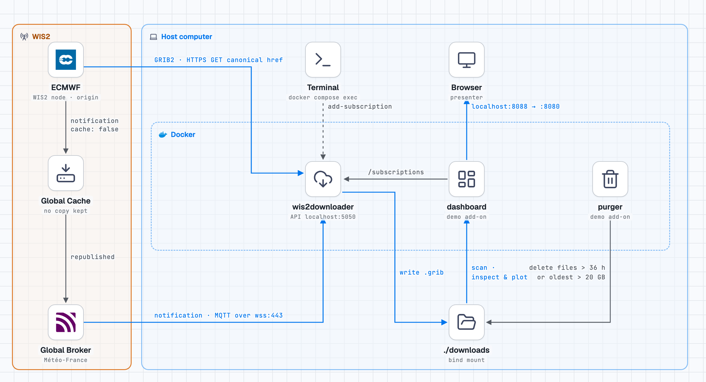

# WIS2 Downloader demo

A self-contained local deployment of the [WIS2 Downloader](https://github.com/World-Meteorological-Organization/wis2downloader). It subscribes to ECMWF's deterministic medium-range forecasts on Météo-France's Global Broker and accumulates the 0.1° IFS GRIB2 files they announce. A purge deletes files older than 36 hours and keeps the pile under 20 GB.

<picture>
  <source media="(prefers-color-scheme: dark)" srcset="docs/wis2downloader-demo-architecture-dark.png">
  
</picture>

ECMWF flags its notifications `"cache": false`. Global Caches therefore republish them without copying the data, and each notification's canonical link points at ECMWF's own WIS2 node, so the GRIB2 files are downloaded straight from ECMWF. This was confirmed from real notifications on 6 November 2026: every one had `"cache": false`, and every download came from `data.ecmwf.int`. The terminal, browser and `./downloads` folder are on the host computer. Only the three containers run in Docker.

| Container | What it does | In the browser |
|---|---|---|
| `downloader` | wis2downloader **0.3.2** (PyPI), the release with the `wis2downloader add-subscription` CLI. It connects to `globalbroker.meteo.fr:443` (MQTT over WebSockets, `everyone`/`everyone`) and saves each announced file to `./downloads/<yyyy>/<mm>/<dd>/<topic>/`. | API and Swagger UI: <http://localhost:5050/swagger> |
| `purger` | Deletes files downloaded more than `RETENTION_HOURS` ago (36 h by default), every 10 minutes. If the pile still exceeds `MAX_DOWNLOAD_GB` (20 GB), the oldest files go first. wis2downloader 0.3.2 never deletes anything itself. | shown on the dashboard |
| `dashboard` | Shows the configuration, the subscriptions and the pile: file count, size, a size-over-time chart and the newest files. It also lets you browse and download the files, and **Inspect & plot** any GRIB file. | <http://localhost:8088> |

**What is wis2downloader, and what isn't.** Only the `downloader` container is wis2downloader: the PyPI package, apart from two small patches applied when the image is built: extra media types, and the path filter (both under *Notes*). Its own web interface is the API and Swagger page on port 5050. The dashboard (including Inspect & plot) and the purger were written for this demo and aren't part of wis2downloader, so say so when presenting. The current wis2downloader (1.0 beta) has its own web UI and Grafana dashboards, but no `add-subscription` CLI (see *Notes*).

## Run it

This demo is for **Linux** only. You need Docker Engine with the Compose plugin (`docker compose`), and a user that can run `docker`. Windows isn't supported.

1. **Set your user and group IDs.** The containers run as you, so the files they write in `./downloads` and `./state` are yours and you can delete them. Check `id -u` and `id -g`. If either isn't 1000, set `HOST_UID` and `HOST_GID` in `.env` to match.
2. **Start it:**
   ```bash
   git clone https://github.com/6a6d74/wis2downloader-demo.git
   cd wis2downloader-demo
   docker compose up -d --build
   ```

Keep `./downloads` and `./state` in place before starting: if they're missing, Docker creates them owned by root.

The first `--build` takes a few minutes: the dashboard image installs earthkit for *Inspect & plot* (about 1.3 GB) and downloads coastline data. Later starts reuse it.

Open <http://localhost:8088>.

## Demo steps

1. **Show the configuration.** On the dashboard, the *Configuration* card shows:
   - the Global Broker, login and download directory
   - the path filter: only `/ifs/0p1/oper/` files, the 0.1° IFS forecasts, are downloaded
   - the 36-hour retention and the 20 GB cap

   Expand *downloader/config.json* to show the downloader's actual config file. The purge settings are in `.env`.
2. **Add the subscription.** Run:
   ```bash
   docker compose exec downloader \
     wis2downloader add-subscription \
     --topic "cache/a/wis2/int-ecmwf/data/core/weather/prediction/forecast/medium-range/deterministic/global"
   ```
   *Subscriptions* on the dashboard turns green and lists the topic. The same list is at <http://localhost:5050/subscriptions>, or from `docker compose exec downloader wis2downloader list-subscriptions`. Subscriptions survive restarts: they're kept in `./state/mqtt_session.json`.
3. **Show the pile.**
   - The tiles show the count and size of files on disk.
   - *Downloaded data on disk* charts the size, one sample a minute. It climbs while ECMWF releases a forecast run, then flattens at about 20 GB as the purger removes the oldest files to stay under the cap.
   - *Most recent files* and **Browse the downloaded files** show the GRIB2 files themselves, in folders by date and topic. They're saved with a `.grib` extension (see *Notes*), for example `20261106000000-102h-oper-fc-pl.grib`.
   - The same files are in `./downloads` on this computer, so you can also open them in a file manager or with GRIB tools such as `grib_ls`.

4. **Look inside a GRIB file.** On the downloads page, press **Inspect & plot** beside any GRIB file (folders don't have the button). An overlay covers the page and shows, side by side:
   - **left:** the file's metadata from `grib_inspect.py`: message count, run, step and level types, grid and encoding (for the 0.1° files: GRIB edition 2, regular lat/lon, 3600 × 1801 points), and every parameter with its levels;
   - **right:** a world map of one field from `grib_plot.py`, with *Parameter* and *Level* menus to replot another.

   It opens on 850 hPa temperature for pressure-level files and 2 m temperature for surface files. Temperatures are shown in °C. A map takes about 5–15 seconds. Close the overlay with **Close**, Esc, or a click outside it; **← Back to the dashboard** at the top of the downloads page returns to the dashboard.

ECMWF publishes on this topic only when a forecast run is released, in bursts a few times a day. For a full pile during the demo, start the stack and add the subscription several hours beforehand. The pile reaches the 20 GB cap within a few hours. Keep the computer from suspending meanwhile, for example with `systemd-inhibit --what=sleep:idle sleep 12h` in a terminal.

## How much data

Measured on 5–7 November 2026. The topic carries forecasts from two ECMWF models, IFS (physics-based) and AIFS (ECMWF's AI model), from each of the four daily runs (00z, 06z, 12z, 18z). The 00z and 12z runs go further ahead than 06z and 18z, so they are bigger:

| Product | Path in the URL | File name ends | Size per file | Files per run | Per run |
|---|---|---|---|---|---|
| IFS 0.1° pressure levels | `ifs/0p1/oper` | `-oper-fc-pl` | ~370 MB | 85 at 00z/12z (to 360 h); 49 at 06z/18z (to 144 h) | 31.7 GB / 18.0 GB |
| IFS 0.1° surface | `ifs/0p1/oper` | `-oper-fc-sfc` | ~95 MB | 85 / 49 | 8.1 GB / 4.6 GB |
| IFS 0.25° | `ifs/0p25/oper` | `-oper-fc` | ~57–100 MB | 49–85 (3-hourly to 144 h, then 6-hourly to 360 h) | ~5–6 GB |
| AIFS Single 0.25° | `aifs-single/0p25/oper` | `-oper-fc` | ~55 MB | up to 61 (6-hourly to 360 h) | ~3 GB |
| Wave, 0.1° and 0.25° | `ifs/…/wave` | `-wave-fc-sfc`, `-wave-fc` | 4–27 MB | 49–85 | ~0.3–1.6 GB |

The 0.1° figures were measured with the path filter on 6–7 November (12z: 170 files, 39.7 GB; 18z: 98 files, 22.6 GB). Lead times are 3-hourly to 144 h, then 6-hourly. The other rows were measured before the filter, when everything was downloaded; IFS 0.25° and AIFS files have the same names, and 0.3.2 then kept only one of each pair (see *Notes*), so the AIFS figures are partly estimated.

**With the path filter, the demo downloads only the first two rows: about 40 GB for a 00z or 12z run and 23 GB for a 06z or 18z run, roughly 125 GB a day in about 540 files.** The whole topic is about 165 GB a day.

**Ball-park figure for the audience:** over 24 hours this one topic delivers roughly **165 GB of unique GRIB2 data in about 1,600 files**, counting each file once: about 125 GB of 0.1° IFS, 22 GB of 0.25° IFS, 12 GB of AIFS and 8 GB of waves. That's an average of about 1.9 MB/s (15 Mbit/s), arriving in bursts as each run is released. The notifications are several times more numerous: each file was announced about 7 times (once per Global Cache republishing it), roughly 11,000 notifications a day. The 0.1° figures are measured; the rest come from about a day of observation before the filter, so treat the total as ±20%. (An earlier estimate here, 120 GB a day, was too low: it assumed every 0.1° run stops at 144 h.) With one download worker, wis2downloader managed about 8 MB/s, about 28 GB an hour. That's plenty over a day, but it falls behind while a run is being published, so files can arrive a few hours after ECMWF releases them.

**Backlog.** While a run is being published, notifications arrive faster than one worker can download, so they queue in the downloader's memory. On 6 November the queue reached about 950 notifications at 10:10Z, roughly three quarters of them repeats that are skipped instantly, and was empty about an hour later, well before the next run. Files therefore land up to a few hours after ECMWF releases them. That doesn't matter for this demo. The queue length is `queue_size` on <http://localhost:5050/metrics>.

**Restart only when the queue is empty.** The downloader keeps its MQTT session on the broker (`clean_session=False`, QoS 1), so notifications published while it's down are delivered when it reconnects. But notifications already in its in-memory queue have been acknowledged, and a restart (`docker compose up -d`, `restart`, `down`) drops them and their files.

**Possible follow-ups,** not needed for the demo:
1. **More workers without duplicates.** Patch 0.3.2 so a worker skips a file another worker is already downloading, which also closes the race behind the 2.7× duplicates (see *Notes*). Then raise `download_workers`: with 4 workers the overall rate was about 17 MB/s, against about 8 MB/s with 1.
2. **Fewer products still.** *Done in part:* the path filter now keeps only 0.1° IFS files (see *Notes*). The 0.1° pressure-level files are about 80% of what's left; `DATA_ID_FILTER=/ifs/0p1/oper/.*-sfc` would keep only the surface files (4.6 GB for a 06z/18z run, 8.1 GB for 00z/12z, in within minutes), at the cost of the upper-air fields.
3. **Show the queue on the dashboard,** from the downloader's `/metrics`, so presenters can see when a restart is safe.

So the **20 GB cap, not the 36-hour retention, is what limits the pile**: 20 GB holds about half of a 00z or 12z run (about 40 GB) or most of a 06z or 18z run (about 23 GB), so the pile is roughly the latest 10–12 hours of files. Overnight on 5–6 November it removed 75 GB, all because of the cap.

**20 GB is fine for the demo.** The point is to see GRIB files arriving and to look inside the ones that have arrived, not to keep a complete archive: a few hours of files, a few dozen of each product, is plenty to browse and inspect. Raise `MAX_DOWNLOAD_GB` only if you need more and the disk has room: holding 36 hours of filtered files would take about 190 GB.

## Change the settings

Edit `.env`, then run `docker compose up -d` (once the queue is empty: see *Restart only when the queue is empty*):

```
RETENTION_HOURS=36        # delete files downloaded more than this long ago
MAX_DOWNLOAD_GB=20        # safety cap: oldest files go first above this; 0 = no cap
PURGE_INTERVAL_MINUTES=10
DATA_ID_FILTER=/ifs/0p1/oper/   # download only matching paths (regex); empty = everything
```

At ECMWF's volume (see *How much data*), the cap does the work and `RETENTION_HOURS` only matters if you raise the cap a lot or subscribe to a quieter topic. The default 20 GB is enough for the demo.

## Stop and clean up

```bash
docker compose down                  # stop; files and subscriptions are kept (check the queue first: see *How much data*)
rm -rf downloads/* state/*           # forget files, subscriptions and history
```

## Notes

- **Why 0.3.2.** The current wis2downloader (1.0 beta, on GitHub) is a larger stack: Redis, Celery workers, Grafana, Loki, Prometheus and a NiceGUI web UI. It has no `wis2downloader add-subscription` command; subscriptions go through its REST API or UI. Its retention setting is in whole days, so it can't do 36 hours.
- **File extensions and one patch to 0.3.2.** 0.3.2 names saved files by media type, not by the name in the URL, and calls anything it doesn't recognise `.bin`. ECMWF announces `application/grib;edition=2`, which 0.3.2 already maps to `.grib`, so ECMWF's `.grib2` files are saved as `.grib`. The image adds other GRIB and BUFR media types used on WIS2 (see `downloader/Dockerfile`), which are saved as `.grib2` and `.bufr4`.
- **One download worker.** `download_workers` is 1 in `downloader/config.json`. Each Global Cache republishes every notification, so each file is announced several times. 0.3.2 skips a file that already exists, but with several workers, two can fetch the same file at once before either has saved it. With 4 workers, ECMWF data was downloaded 2.7 times over; with 1 there were no duplicates (2,926 repeat notifications skipped in 10 hours). The cost is speed: see *How much data*.
- **The path filter (a second patch to 0.3.2).** ECMWF's deterministic topic carries four products: IFS 0.1° (`ifs/0p1/oper`), IFS 0.25° (`ifs/0p25/oper`), waves (`ifs/0p25/wave`) and AIFS Single 0.25° (`aifs-single/0p25/oper`). The demo keeps only the first. `downloader/patch_filter.py`, applied when the image is built, drops every notification whose `properties.data_id` and canonical link both fail to match `DATA_ID_FILTER` (a regular expression in `.env`, default `/ifs/0p1/oper/`) before it reaches the download queue; the log says `Filtered out (not …)`. `DATA_ID_FILTER=` (empty) turns it off; after a change, run `docker compose up -d` once the queue is empty. Tested on 820 real notifications from 6 November: all 186 for `ifs/0p1/oper` were queued, and all 46 AIFS, 294 IFS 0.25° and 294 wave notifications were dropped. Filtering also keeps the queue short: about two thirds of the topic's notifications never enter it.
- **Why filter on the path.** Nothing else in a notification separates the products reliably:
  - **Clashing file names.** IFS 0.25° and AIFS files are both named `<run>-<step>h-oper-fc.grib2`; only the path tells them apart. 0.3.2 saves every file by name alone, in one folder per topic, so without the filter, at each step both models share, whichever file arrived first was kept and the other skipped as "already exists". A `-oper-fc.grib` on disk could be from either model (**Inspect & plot** shows `marsClass` `od` for IFS, `ai` for AIFS). The 0.1° files have names of their own (`-oper-fc-pl`, `-oper-fc-sfc`), so with the filter nothing clashes.
  - **A shared `metadata_id`.** 0.1° IFS, 0.25° IFS and wave notifications all carry the same discovery-record id. For the 6 November 06z run it was `urn:wmo:md:int-ecmwf:ifs:oper:short-forecast`. 00z and 12z probably use `urn:wmo:md:int-ecmwf:ifs:oper:forecast` instead; that hasn't been confirmed. ECMWF's IFS records describe only 0.25° data, so a 0.1° file's `metadata_id` leads to a description of a different resolution. Only AIFS has its own (`urn:wmo:md:int-ecmwf:aifs:oper:forecast`).
  - **Same media type, same topic:** `application/grib;edition=2` for all of them.
- **What a notification contains.** For example, a 0.1° file from 6 November 2026:
  - `properties.data_id`: `wis2/int-ecmwf/data/core/weather/prediction/forecast/medium-range/deterministic/global/20261106/06z/ifs/0p1/oper/20261106060000-0h-oper-fc-sfc.grib2`
  - `properties.metadata_id`: the WIS2 discovery record, `urn:wmo:md:int-ecmwf:ifs:oper:short-forecast` (see *Why filter on the path*)
  - `properties.cache`: `false`
  - the `canonical` link: `https://data.ecmwf.int/forecasts/20261106/06z/ifs/0p1/oper/20261106060000-0h-oper-fc-sfc.grib2`, with its `length` in bytes (78,975,294)
  - an `alternate` link to the same file on Azure (`ai4edataeuwest.blob.core.windows.net/ecmwf/…`), which wis2downloader doesn't use.

  Each file was announced about 5–7 times, once per Global Cache republishing it, but only some copies carry a `global-cache` property naming the cache.
- **Duplicates under different names.** 0.3.2 skips a file only if one with the same name already exists that day. If two Global Caches name the same file differently, it's saved twice. This was seen with NOAA test data, not ECMWF.
- **Inspect & plot.** These are dashboard features, not part of wis2downloader.
  - **Scripts:** the dashboard runs copies of `grib_inspect.py` and `grib_plot.py` from grib-utils, unchanged, in `dashboard/grib_utils/`. They were copied on 6 November 2026, after two fixes to `grib_plot.py` in grib-utils: fields stored in kelvin are shown in °C with earthkit's own temperature colours (before, only `t` was), and titles name the level only where it adds something (`2 metre temperature`, not `… at heightAboveGround 2`). If grib-utils changes, copy the scripts again.
  - **Image:** `dashboard/Dockerfile` (about 1.3 GB) installs the versions grib-utils was tested with, earthkit-data 1.3.1 and earthkit-plots 1.0.4, and downloads the coastlines at build time, so plotting needs no network. It sets `HOME` and `USER`, because earthkit looks up the user name and the host user has no entry in the image.
  - **Server:** `/api/inspect` and `/api/plot` run the scripts on a file under `./downloads` only, and only for `.grib`, `.grib2`, `.grb` and `.grb2` files. The overlay's parameter list comes from the GRIB headers, read with ecCodes. One plot runs at a time, and the newest 100 maps are cached in the container. A file purged while you look at it gives a "may have been purged" message.
- **Running as you.** All three containers run as `HOST_UID:HOST_GID` from `.env`. The downloader also sets `HOME=/tmp`, because gunicorn keeps a control socket in the home directory and that user has none in the image.
- **Ports.**
  - Host port 5050 maps to the downloader's 5000, which is often taken on the host. Inside the container, 5000 is the CLI's default, so `add-subscription` needs no `--port`.
  - The dashboard is on 8088.
  - Both ports listen on `127.0.0.1` only.

## Licence and credits

The code in this repository is licensed under the [Apache License 2.0](LICENSE). That includes the copies of `grib_inspect.py` and `grib_plot.py` in `dashboard/grib_utils/`.

- **Data:** the GRIB files this demo downloads are [ECMWF open data](https://www.ecmwf.int/en/forecasts/datasets/open-data), licensed under CC-BY-4.0 and subject to the [ECMWF Terms of Use](https://apps.ecmwf.int/datasets/licences/general/). Data © ECMWF. They aren't part of this repository.
- **Software:** [wis2downloader](https://github.com/World-Meteorological-Organization/wis2downloader) is WMO's, installed from PyPI at build time; [earthkit](https://github.com/ecmwf/earthkit) and ecCodes are ECMWF's.
- **Diagram:** the logos in `docs/` (ECMWF, MQTT, Docker) are trademarks of their owners and are used only to identify the components.
- This is an independent demo. It isn't produced, endorsed or supported by ECMWF or WMO.
